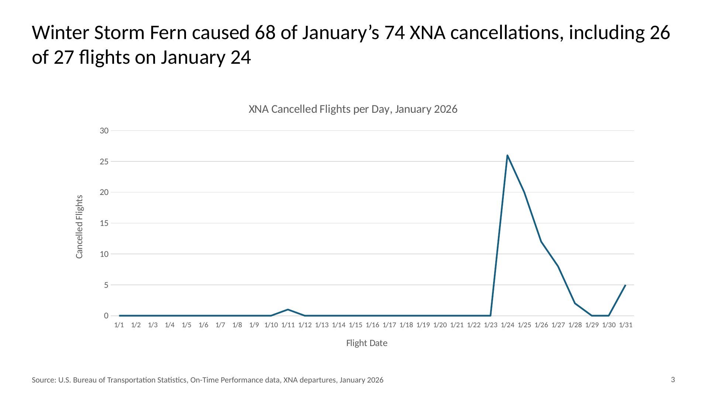
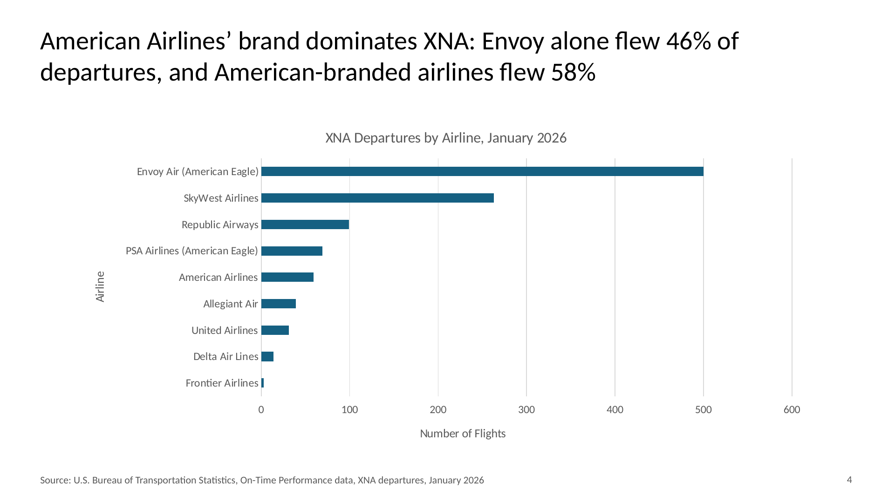
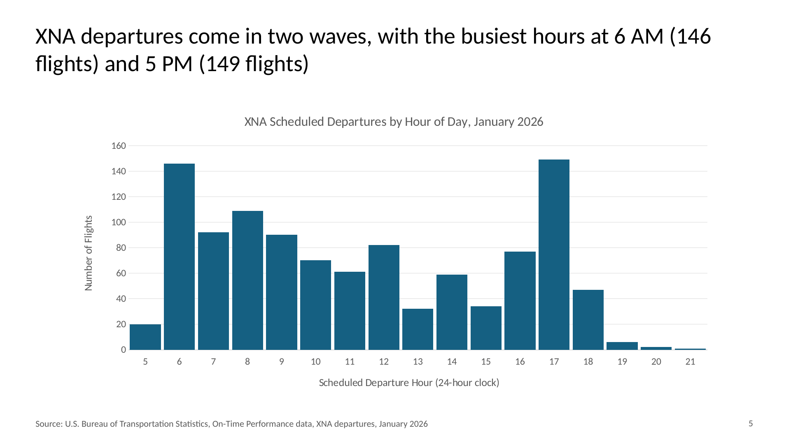
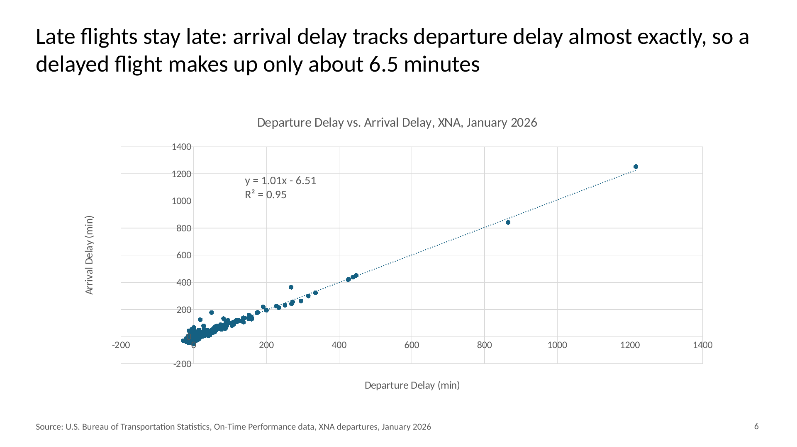

## Team Members

This project was completed by:

- [Liam Chimka](https://liamchimka.github.io/)
- [Dilan Colin](https://DilanColin.github.io/)
- [Juan Pablo Haro](https://jp-haro.github.io/)
- [Kareem Abu-Saif](https://kareemabusaif.github.io/)
- [Eric Mullalli](https://erikmullalli.github.io/)

## The Data Set

Our data set contains every flight scheduled to depart Northwest Arkansas National Airport (XNA) in January 2026: 1,077 flights, one row per flight. We downloaded it from the U.S. Bureau of Transportation Statistics (BTS) On-Time Performance database, which records the airline, destination, scheduled departure time, departure and arrival delays, and whether the flight was cancelled for every domestic flight flown by a major U.S. airline.

We copied the data into an Excel workbook and cleaned it:

- Kept only flights leaving XNA and removed columns we did not need.
- Gave every column a meaningful name with units, such as *Dep Delay (Min)* and *Arrival Delay (Min)*.
- Added an *Airline Name* column using `VLOOKUP` on an *Airline Lookup* sheet, so two-letter codes such as MQ and OO became names such as Envoy Air and SkyWest Airlines (9 airlines in total).
- Converted the HHMM departure times into real clock times with `TIME` and pulled out a *Departure Hour* column with `HOUR`.
- Checked every blank cell. The 74 cancelled flights have no delay values, and one diverted flight has no arrival delay. We kept these rows and added a *Data Note* column that explains each blank (using `IF`), so a blank is never mistaken for zero.

All of the analysis below is in a *Charts* sheet in the same workbook. Every number is a formula on the cleaned data, so the charts update if the data changes.

## Question 1: How many XNA flights were cancelled each day in January 2026?

**Why this question is interesting to us:** XNA is the airport we use to fly home and back, so we wanted to know how often flights there are cancelled and whether cancellations happen evenly or all at once.

**How we used Excel to answer the question:** We made a table with one row for each day from January 1 to January 31. For each day, `=COUNTIFS('XNA FLIGHTS'!A:A, date, 'XNA FLIGHTS'!L:L, 1)` counts the flights on that date with *CANCELLED 1=yes* equal to 1. A `SUM` of the column checks that the daily counts add up to all 74 cancellations.

**How we developed the visual:** Because the question is about change over time, we used a line chart (our time-series plot) with *Flight Date* on the horizontal axis and cancelled flights on the vertical axis. We kept Excel's default style, added a title and axis titles, and turned off the legend since there is only one series. The spike from January 24 to 28 lines up with Winter Storm Fern, which brought snow and ice to Arkansas that weekend, so that became the assertion on our slide.

{fig-alt="Slide stating that Winter Storm Fern caused 68 of January's 74 XNA cancellations, with a line chart of cancelled flights per day that is near zero until a spike of 26 on January 24."}

## Question 2: Which airlines operate the most flights out of XNA?

**Why this question is interesting to us:** When we book flights home, we see many airline names, but we did not know who actually flies out of XNA. We wanted to know how much choice travelers really have.

**How we used Excel to answer the question:** We listed the 9 airlines and counted each one's departures with `=COUNTIF('XNA FLIGHTS'!C:C, airline name)` on the *Airline Name* column. We sorted the table from most to fewest flights and used `SUM` to confirm the total of 1,077.

**How we developed the visual:** We used a horizontal bar chart because the airline names are long and read more easily on the vertical axis. Bars are sorted with the largest airline at the top. Envoy Air, PSA Airlines and American Airlines mainline all fly under the American brand, so together they make 628 of 1,077 flights (58%). That share became our assertion.

{fig-alt="Slide stating that Envoy alone flew 46 percent of XNA departures and American-branded airlines flew 58 percent, with a horizontal bar chart of flights by airline led by Envoy Air with 500."}

## Question 3: At what hours of the day are XNA flights scheduled to leave?

**Why this question is interesting to us:** Picking a flight time is one of the first choices a traveler makes. We wanted to see whether XNA's flights are spread through the day or bunched into certain hours.

**How we used Excel to answer the question:** Using the *Departure Hour* column (made with `HOUR`), we built a frequency table for every hour from 5 (5 AM) to 21 (9 PM) with `=COUNTIF('XNA FLIGHTS'!I:I, hour)`. The counts add up to all 1,077 flights.

**How we developed the visual:** We made a histogram from the frequency table using a column chart, with the gap width set to 10% so the bars sit next to each other like a histogram's bins. The hour of day is on the horizontal axis (24-hour clock) and the number of flights on the vertical axis. The two tallest bars, 6 AM and 5 PM, show the two waves of departures our assertion describes.

{fig-alt="Slide stating that XNA departures come in two waves, with a histogram of flights by scheduled departure hour peaking at 146 flights at 6 AM and 149 at 5 PM."}

## Question 4: Do flights that leave late make up the time in the air?

**Why this question is interesting to us:** When a flight leaves late, airlines often say the pilots will "make up time." We wanted to test whether that is true for flights out of XNA.

**How we used Excel to answer the question:** We compared *Dep Delay (Min)* with *Arrival Delay (Min)* for the 1,002 flights that were completed (cancelled flights have no delays, so Excel skips them). We used `CORREL` to measure how closely the two delays are related (r = 0.98), and `SLOPE` and `INTERCEPT` to find the line that fits them: arrival delay = 1.01 × departure delay − 6.51 minutes.

**How we developed the visual:** We used a scatter plot with departure delay on the horizontal axis and arrival delay on the vertical axis, one dot per flight. We added Excel's linear trendline and displayed its equation and R² (0.95) on the chart. Because the slope is about 1, a flight's arrival delay is almost the same as its departure delay, and the intercept shows flights recover only about 6.5 minutes on average. That became our assertion.

{fig-alt="Slide stating that arrival delay tracks departure delay almost exactly, with a scatter plot of departure versus arrival delay and a linear trendline y = 1.01x - 6.51 with R squared 0.95."}

## Source

U.S. Bureau of Transportation Statistics, *Airline On-Time Performance Data*, flights departing XNA, January 2026.
